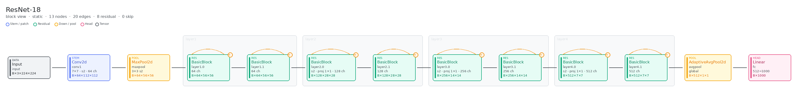
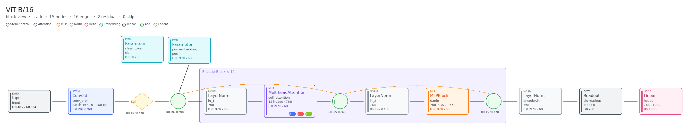
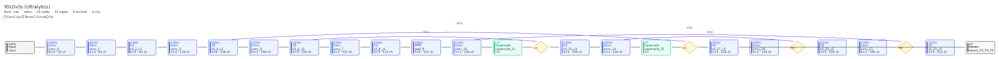

# nn2excalidraw

[中文版](./README_zh.md)

A skill that turns PyTorch `nn.Module` code into a deterministic Excalidraw architecture diagram. The agent chooses the entry module; a layout engine places every box, so the same code always yields the same picture. The default view is block-level: a residual block stays one card, and a Vision Transformer shows patch embed, the class token, and one expanded encoder block marked × 12.

Agents follow [`skills/nn2excalidraw/SKILL.md`](skills/nn2excalidraw/SKILL.md).

## Showcase

### ResNet-18



Stem, four stages, and a dashed residual arc on each BasicBlock. Stride-2 blocks are marked with a 1×1 projection.

- [resnet18.excalidraw](examples/outputs/resnet18.excalidraw)
- [resnet18.excalidraw.md](examples/outputs/resnet18.excalidraw.md) (Obsidian)

### ViT-B/16



Patch embed, class token, positional add, then one expanded encoder block labeled × 12 (attention with QKV, MLP, and both residual adds), followed by the class-token readout and the linear head.

- [vit_b_16.excalidraw](examples/outputs/vit_b_16.excalidraw)
- [vit_b_16.excalidraw.md](examples/outputs/vit_b_16.excalidraw.md) (Obsidian)

## Installation

### Claude Code

```bash
claude plugin marketplace add https://github.com/bot66/nn2excalidraw
claude plugin install nn2excalidraw
```

### Cursor

```bash
git clone https://github.com/bot66/nn2excalidraw.git ~/.cursor/nn2excalidraw
```

Point Cursor's skills path at `~/.cursor/nn2excalidraw/skills/`.
Windows setup and verification: [`.cursor-plugin/INSTALL.md`](.cursor-plugin/INSTALL.md).

### Codex

```bash
git clone https://github.com/bot66/nn2excalidraw.git ~/.codex/nn2excalidraw

mkdir -p ~/.agents/skills
ln -s ~/.codex/nn2excalidraw/skills ~/.agents/skills/nn2excalidraw
```

Restart Codex to discover the skill. Windows instructions: [`.codex/INSTALL.md`](.codex/INSTALL.md).

### OpenCode

```bash
git clone https://github.com/bot66/nn2excalidraw.git ~/.nn2excalidraw

mkdir -p ~/.config/opencode/skills
ln -s ~/.nn2excalidraw/skills/nn2excalidraw ~/.config/opencode/skills/nn2excalidraw
```

Restart OpenCode to discover the skill. See [`.opencode/INSTALL.md`](.opencode/INSTALL.md).

## Usage

Talk to the agent in natural language. A repository URL plus the variant or class name, and a request to save as Excalidraw, is enough:

```
Draw the YOLOv5s model architecture from https://github.com/ultralytics/yolov5 and save it as Excalidraw.
```



## License

[MIT](./LICENSE).
