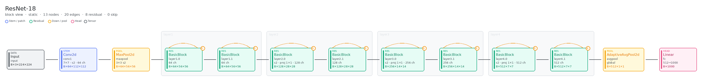
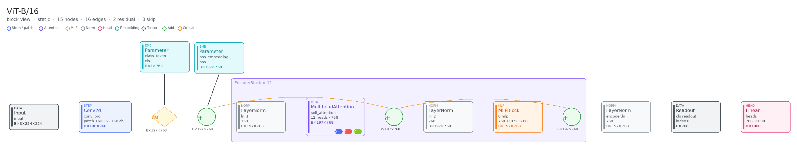

# nn2excalidraw

[English](./README.md)

一个技能：把 PyTorch `nn.Module` 代码转成确定性的 Excalidraw 架构图。智能体选择入口模块，布局引擎摆放每一个框，同一份代码得到同一张图。默认是块级视图：残差块仍是一张卡片，Vision Transformer 画出 patch embed、class token，以及一个标了 × 12 的展开编码器块。

智能体按 [`skills/nn2excalidraw/SKILL.md`](skills/nn2excalidraw/SKILL.md) 执行。

## 效果

### ResNet-18



Stem、四个 stage，每个 BasicBlock 一条虚线残差弧。stride 为 2 的块标了 1×1 投影。

- [resnet18.excalidraw](examples/outputs/resnet18.excalidraw)
- [resnet18.excalidraw.md](examples/outputs/resnet18.excalidraw.md)（Obsidian）

### ViT-B/16



Patch embed、class token、位置编码相加，然后一个标了 × 12 的展开编码器块（带 QKV 的注意力、MLP、两次残差加），最后是 class token 读出和线性头。

- [vit_b_16.excalidraw](examples/outputs/vit_b_16.excalidraw)
- [vit_b_16.excalidraw.md](examples/outputs/vit_b_16.excalidraw.md)（Obsidian）

## 安装

### Claude Code

```bash
claude plugin marketplace add https://github.com/bot66/nn2excalidraw
claude plugin install nn2excalidraw
```

### Cursor

```bash
git clone https://github.com/bot66/nn2excalidraw.git ~/.cursor/nn2excalidraw
```

把 Cursor 的 skills 路径指到 `~/.cursor/nn2excalidraw/skills/`。
Windows 的安装与校验见 [`.cursor-plugin/INSTALL.md`](.cursor-plugin/INSTALL.md)。

### Codex

```bash
git clone https://github.com/bot66/nn2excalidraw.git ~/.codex/nn2excalidraw

mkdir -p ~/.agents/skills
ln -s ~/.codex/nn2excalidraw/skills ~/.agents/skills/nn2excalidraw
```

重启 Codex 以发现技能。Windows 说明见 [`.codex/INSTALL.md`](.codex/INSTALL.md)。

### OpenCode

```bash
git clone https://github.com/bot66/nn2excalidraw.git ~/.nn2excalidraw

mkdir -p ~/.config/opencode/skills
ln -s ~/.nn2excalidraw/skills/nn2excalidraw ~/.config/opencode/skills/nn2excalidraw
```

重启 OpenCode 以发现技能。详见 [`.opencode/INSTALL.md`](.opencode/INSTALL.md)。

## 许可证

[MIT](./LICENSE)。
